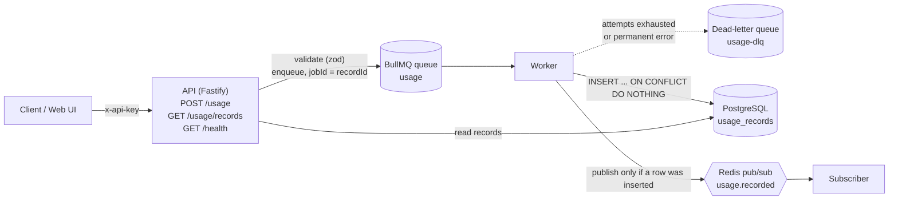

# Usage Metering Pipeline

An event-driven pipeline that ingests usage records (for example "customer `acme` used 3
`api_calls`"), stores each one exactly once, and announces every newly stored record as an
event.

- **API** (Fastify): validates records with zod and enqueues them. It answers `202 Accepted`
  without waiting for the database.
- **Queue** (BullMQ on Redis): decouples ingest from storage. Failed jobs are retried with
  exponential backoff and then moved to a dead-letter queue.
- **Worker**: inserts each record into PostgreSQL idempotently and publishes `usage.recorded`
  on Redis pub/sub.
- **Subscriber**: consumes `usage.recorded` events (currently it logs them).
- **Web** (Vite + React): shows a customer's records with auto-refresh and has a form for
  submitting test records.

Business logic is written as pure functions with injected dependencies (queue, repository,
publisher, clock). Each one can be wrapped as a serverless handler without changes.

## Architecture



## Repository layout

| Path      | Contents                                                                    |
| --------- | --------------------------------------------------------------------------- |
| `shared/` | zod schemas and types: usage record, queue contract, `usage.recorded` event |
| `api/`    | Fastify server                                                              |
| `worker/` | Queue consumer and event subscriber                                         |
| `web/`    | Vite + React + TypeScript page                                              |
| `db/`     | SQL migrations and the migration runner                                     |
| `e2e/`    | End-to-end integration test of the whole pipeline                           |

## Usage record contract

`POST /usage` with header `x-api-key: <API_KEY>` and a JSON body:

```json
{
  "recordId": "5f0c6a0e-3b1d-4b7e-9a51-2f6f8e1d9c11",
  "customerId": "acme",
  "dimension": "api_calls",
  "quantity": 3,
  "timestamp": "2026-11-03T10:15:00Z"
}
```

| Field        | Rule                                                              |
| ------------ | ----------------------------------------------------------------- |
| `recordId`   | UUID, chosen by the client. It is the idempotency key.            |
| `customerId` | String, 1–64 characters                                           |
| `dimension`  | String, 1–64 characters (what is being metered)                   |
| `quantity`   | Number, greater than 0                                            |
| `timestamp`  | ISO 8601 UTC datetime (`Z`), no more than 5 minutes in the future |

Unknown fields are rejected.

**Responses**

| Status | Body                                                              | Meaning                               |
| ------ | ----------------------------------------------------------------- | ------------------------------------- |
| `202`  | `{ "status": "accepted", "recordId": "..." }`                     | Validated and queued. Safe to resend. |
| `400`  | `{ "error": "validation_failed", "errors": [{ path, message }] }` | The body broke a rule above.          |
| `401`  | `{ "error": "unauthorized", ... }`                                | Missing or wrong `x-api-key`.         |
| `503`  | `{ "error": "queue_unavailable", ... }` + `Retry-After`           | Redis is unreachable. Retry later.    |

**Reading records:** `GET /usage/records?customerId=acme&limit=100` (requires `x-api-key`)
returns `{ "records": [...] }`, newest first. `limit` is 1–500 and defaults to 100. Unknown
query parameters are rejected with `400`.

**Health:** `GET /health` (no key) returns `200` with `status: "ok"`, or `503` with
`status: "degraded"`, and reports Redis and Postgres separately.

**Event:** after a record is newly stored, the worker publishes this on the `usage.recorded`
channel:

```json
{
  "version": 1,
  "type": "usage.recorded",
  "recordId": "5f0c6a0e-3b1d-4b7e-9a51-2f6f8e1d9c11",
  "customerId": "acme",
  "dimension": "api_calls",
  "quantity": 3,
  "occurredAt": "2026-11-03T10:15:00Z",
  "recordedAt": "2026-11-03T10:15:01.234Z"
}
```

A breaking change to the event gets a new `version`.

## Design decisions

### Queue plus idempotent consumer

The API only validates and enqueues, so ingest stays fast and keeps working while Postgres is
slow or down. The price is at-least-once delivery: a client may resend after a timeout, and
the queue may hand the same job to the worker twice (for example after a worker crash). The
consumer is therefore built to be safe to run any number of times for the same record.

The job id is set to `recordId`, which makes BullMQ ignore an exact duplicate while the
original job is still held in Redis. That is only a shortcut: completed jobs are pruned
after 24 hours or 1,000 jobs, so it cannot be the guarantee.

### `INSERT ... ON CONFLICT DO NOTHING`

Idempotency lives in Postgres, never in memory. `record_id` is the primary key of
`usage_records`, and the worker runs:

```sql
INSERT INTO usage_records (record_id, customer_id, dimension, quantity, occurred_at)
VALUES ($1, $2, $3, $4, $5)
ON CONFLICT (record_id) DO NOTHING
RETURNING record_id
```

If `RETURNING` yields a row, this call inserted the record. If it yields nothing, the record
already existed and the job is a duplicate. This holds across worker restarts, multiple
worker processes and concurrent deliveries, because the database enforces it atomically. All
SQL is parameterized.

### Retries and the dead-letter queue

Each job gets 5 attempts with exponential backoff (about 1s, 2s, 4s and 8s between them).
Errors are classified before deciding what to do:

- **Transient** (connection refused or reset, timeouts, deadlocks, Postgres shutting down):
  the job is retried. Unknown errors are treated as transient, since retries are bounded
  anyway.
- **Permanent** (invalid job data, Postgres data or constraint errors): retrying cannot help,
  so the job fails immediately.

When a job fails permanently or runs out of attempts, the worker copies it to the `usage-dlq`
queue together with the failure reason, attempt count and time. Dead-lettered jobs are kept
until someone inspects them. Their job id is the `recordId`, so moving the same record twice
has no effect.

### Events

`usage.recorded` is published only when a row was actually inserted, so duplicates never
produce a second event. Events are best-effort notifications, and Postgres is the source of
truth. If publishing fails after the insert, the worker logs a lost event and still completes
the job: retrying would only hit the duplicate path and could not publish anyway. Closing
this gap properly is the outbox pattern, listed below.

Redis pub/sub is fire-and-forget: a subscriber that is down when an event is published never
receives it. That is acceptable for the current logging subscriber but not for consumers that
need every event.

## Running locally

Requirements: Node.js 22 or newer (`.nvmrc` pins 26) and Docker.

```sh
# 1. Configuration
cp .env.example .env              # set API_KEY to a random string of 16+ characters
cp web/.env.example web/.env      # set VITE_API_KEY to the same value

# 2. Dependencies and infrastructure
npm install
docker compose up -d              # Postgres 16 and Redis 7
npm run db:migrate                # applies db/*.sql; safe to rerun

# 3. Processes (one terminal each)
npm run dev:api                   # http://localhost:3000
npm run dev:worker
npm run dev:subscriber
npm run dev:web                   # http://localhost:5173
```

Send a record:

```sh
curl -i -X POST http://localhost:3000/usage \
  -H "content-type: application/json" \
  -H "x-api-key: $API_KEY" \
  -d '{"recordId":"5f0c6a0e-3b1d-4b7e-9a51-2f6f8e1d9c11","customerId":"acme","dimension":"api_calls","quantity":3,"timestamp":"2026-11-03T10:15:00Z"}'
```

Send it again: you get another `202`, but there is still one row and the subscriber logs one
event.

The `VITE_*` values are compiled into the browser bundle, so `VITE_API_KEY` is visible to
anyone who loads the page. That is fine for local development only.

### Checks

| Command                | What it runs                                                 |
| ---------------------- | ------------------------------------------------------------ |
| `npm test`             | Unit tests (Vitest, Node and browser projects)               |
| `npm run test:int`     | Integration and end-to-end tests (needs `docker compose up`) |
| `npm run build`        | `tsc -b` across workspaces, then the Vite build              |
| `npm run lint`         | ESLint with type-aware rules                                 |
| `npm run format:check` | Prettier                                                     |

GitHub Actions (`.github/workflows/ci.yml`) runs lint, build, unit tests, migrations and
integration tests against Postgres and Redis service containers on every push and pull
request.

## What I would do next

- **Outbox pattern.** Write the record and an `outbox` row in the same Postgres
  transaction, and have a separate relay publish outbox rows and mark them sent. That turns
  events from best-effort into at-least-once and removes the "inserted but event lost" case.
  Moving events to a durable stream (Redis Streams or a broker) instead of pub/sub would
  let consumers that were offline catch up.
- **Real authentication.** Replace the single shared API key with per-client credentials
  (hashed API keys in the database, or OAuth2 client credentials / JWTs). Bind each
  credential to the customers it may write for, and add rate limiting per client. The web
  page would get a backend-for-frontend or a user login instead of a key in the bundle.
- **Metrics.** Expose Prometheus metrics: ingest rate and latency, `400`/`503` counts, queue
  depth and job age, processing duration, retry count, duplicates, inserts, and lost events.
  Add tracing (OpenTelemetry) from the HTTP request through the job to the insert.
- **Alerts on dead-letter queue depth.** Alert when `usage-dlq` holds any jobs (or more than
  a small threshold) and when the main queue's oldest job gets too old. Add a small tool to
  inspect, replay and discard dead-lettered jobs.
- **Port to AWS.** The pure use cases (`createIngestUsage`, `createUsageJobProcessor`)
  stay as they are, and only the adapters change:
  - API Gateway + Lambda for ingest, enqueueing to **SQS**.
  - A Lambda consuming SQS for processing. SQS `maxReceiveCount` plus a redrive policy
    replaces BullMQ's attempts and the dead-letter queue.
  - **DynamoDB** as the store, with `PutItem` and `attribute_not_exists(recordId)` as the
    conditional write that replaces `ON CONFLICT DO NOTHING`. The read path needs a
    `customerId` partition key with `occurredAt` as sort key (or a GSI).
  - **EventBridge** for `usage.recorded`, with rules routing events to consumers. DynamoDB
    Streams feeding EventBridge Pipes gives the outbox guarantee without a relay.
  - Alarms in CloudWatch on the SQS dead-letter queue's `ApproximateNumberOfMessagesVisible`.
